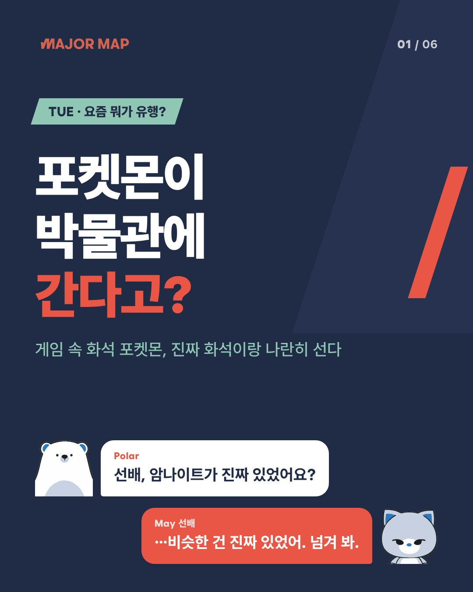

# MM_Insta — 메이저맵 인스타 카드뉴스 스튜디오

**웹: https://mm-insta-studio.vercel.app** (비밀번호는 Vercel 환경변수 `APP_PASSWORD`, 상태 확인: `/api/health`)

평일마다 그날 올릴 인스타 카드뉴스(6장 + 본문 + 해시태그)를 AI가 만들어 두고, 올리는 사람은 웹페이지에서 **클릭으로 사진·본문·해시태그를 복사해 그대로 올리는** 서비스입니다.

| 요일 | 편 | 소재 |
|---|---|---|
| 월·수·금 | **입시 브리핑** | 노션 「2026-10-17_최근 입시 트렌드」 리포트 주제 섹션 → 다 쓰면 「베리타스알파 구독자 기사 아카이브」 |
| 화·목 | **요즘 트렌드** (고등학생 톤) | 노션 「캐릿 아티클 아카이브」 + 「캐릿 마이크로 트렌드 아카이브」 → **웹 리서치로 캐릿 밖 근거를 붙여서만** 게시 |
| 공통 | 메이저맵에서 더 보기 | 노션 「메이저맵 콘텐츠 DB」에서 주제가 닿는 글 2개를 본문에 링크 |

**캐릿 내용은 그대로 올리지 않습니다.** 트렌드 편은 Claude 웹 검색으로 공식 발표·언론·공공 통계를 찾아 섞고(예: 포켓몬 화석박물관 × 지난달 천연기념물이 된 한국 공룡), 자동 검수 G5가 ① 캐릿 밖 출처가 있는지 ② 그 출처의 팩트가 카드에 실렸는지 ③ 캐릿 문장과 5어절 이상 겹치지 않는지 확인합니다. 하나라도 어기면 게시하지 않습니다.



## 흐름

```
[GitHub Actions] 월~금 06:00 KST
  ① 요일로 편 결정 → 노션에서 안 쓴 소재 1건 선택
     트렌드 편: 웹 리서치(Claude 웹 검색) — 캐릿 밖 출처가 안 붙으면 다음 소재로 (최대 3건)
     공통: 메이저맵 콘텐츠 DB에서 연결 글 2개
  ② 팩트 추출 (Claude Sonnet 5.5) — 숫자마다 출처·기준일, 트렌드 편은 리서치 팩트 필수
  ③ 작가 May·Polar (Claude Sonnet 5.5) — 입시: 6장 브리핑 / 트렌드: 유행+리서치 3장 + 진로 연결
  ④ 자동 검수 G1 숫자 · G2 원문 베끼기 · G3 톤·글자 수 · G5 캐릿 섞기(트렌드) → 탈락 시 사유를 주고 1회 재작성
  ⑤ HTML 템플릿 → 1080×1350 JPEG 6장 + G4 넘침·폰트 검사
  ⑥ Supabase 저장 (insta_posts 행 + insta-cards 이미지)
        ↓
[웹 · Vercel] 인스타 스튜디오
  이번 주 월~금 보드 → 날짜 클릭 → 사진 공유/저장/복사 · 본문·해시태그 복사 · '올렸어요' 표시
```

**숫자는 코드가 넣습니다.** 작가는 `{f3}`처럼 팩트 번호만 쓰고, 원고에 숫자를 직접 쓰면 G1에서 탈락합니다. 검수를 통과하지 못하면 그날 카드는 `생성 실패`로 남고 웹에서 다시 만들 수 있습니다.

## 웹 — 올리는 사람이 하는 일

1. 스튜디오 접속 → 오늘 날짜 카드 클릭
2. **휴대폰**: 아래 `사진 6장 공유 + 본문 복사` → 공유창에서 인스타그램 선택 → 본문 칸에 붙여넣기
   **PC**: `6장 모두 저장` → 인스타 웹에서 6장 선택 → `본문 + 해시태그 한 번에 복사` 후 붙여넣기
3. 올렸으면 `인스타에 올렸어요` → 보드에 ✓ 업로드 완료 표시

## 설정

### GitHub Secrets (생성용 — 저장소 Settings → Secrets and variables → Actions)

| 이름 | 값 |
|---|---|
| `ANTHROPIC_API_KEY` | Claude API 키 (트렌드 편 리서치에 **웹 검색**을 쓰므로 Console에서 웹 검색이 켜져 있어야 함) |
| `NOTION_TOKEN` | 노션 통합 토큰. 아래 다섯 곳을 이 통합에 **연결**해야 읽힘: 「최근 입시 트렌드」 리포트 페이지 · 베리타스 아카이브 DB · 캐릿 아티클 아카이브 DB · 캐릿 마이크로 트렌드 아카이브 DB · 메이저맵 콘텐츠 DB (상위 「콘텐츠 DB」 페이지를 연결하면 한 번에 됨) |
| `SUPABASE_URL` | `https://recajgmjuhintkpazkfi.supabase.co` (majormap-studio) |
| `SUPABASE_SERVICE_ROLE_KEY` | Supabase → Project Settings → API Keys의 service_role(또는 secret) 키 |

크론과 웹의 '다시 만들기' 버튼은 워크플로가 **저장소 기본 브랜치**(현재 `claude/new-hoon-repository-up5bmo`)에 있어야 동작합니다. 이 작업 브랜치를 기본 브랜치에 합치면 켜집니다.

### Vercel 환경변수 (웹 — 프로젝트 `mm-insta-studio`, Root Directory `MM_Insta/web`)

| 이름 | 필수 | 값 |
|---|---|---|
| `SUPABASE_URL` | ✓ | 위와 같음 |
| `SUPABASE_PUBLISHABLE_KEY` | ✓ | publishable 키 (읽기 전용, 서버에서만 사용) |
| `APP_PASSWORD` |  | 설정하면 접속 시 비밀번호를 묻습니다 (아이디는 아무거나) |
| `GITHUB_TOKEN` |  | '지금 만들기/다시 만들기' 버튼용. fine-grained 토큰, 이 저장소 **Actions: Read and write** |
| `GITHUB_REF` |  | 워크플로를 실행할 브랜치 = 기본 브랜치 (설정됨: `claude/new-hoon-repository-up5bmo`) |

### Supabase (majormap-studio, 적용 완료)

- `public.insta_posts` — 날짜당 1행. 웹은 읽기만(RLS), 쓰기는 service_role
- `public.insta_set_posted(id, bool)` — 웹의 '올렸어요' 표시만 바꾸는 RPC
- Storage `insta-cards` (공개) — `YYYY-MM-DD/v{버전}/01~06.jpg`
- 스키마: [`supabase/migrations/20261017_insta_studio.sql`](supabase/migrations/20261017_insta_studio.sql)

## 로컬 실행

```bash
cd MM_Insta
pip install -r requirements.txt && python -m playwright install chromium
cp .env.example .env    # 키 입력

python -m mm_insta.pipeline --date 2026-10-26              # 그 날짜 편으로 생성 (out/에 저장)
python -m mm_insta.pipeline --date 2026-10-26 --publish    # + Supabase 저장
python -m mm_insta.pipeline --date 2026-10-27 --page <노션 페이지 id>   # 소재 직접 지정
python -m mm_insta.pipeline --date 2026-10-27 --topic-file fixtures/seed/2026-10-27/topic.json \
    --offline fixtures/seed/2026-10-27                     # API 키 없이 저장된 원고로 렌더
python -m pytest -q

cd web && npm install && cp .env.example .env.local && npm run dev
```

## 구조

```
MM_Insta/
├── mm_insta/
│   ├── pipeline.py          # 오케스트레이터 CLI (요일→편, 생성, --publish)
│   ├── config.py            # 요일 규칙·브랜드·글자 수 제한·금칙어
│   ├── models.py            # 소재·팩트·작가 출력(입시/트렌드) → script.json
│   ├── sources/notion.py    # 리포트 섹션 · 베리타스 · 캐릿 아티클·마이크로 트렌드 · 메이저맵 콘텐츠 DB
│   ├── agents/              # 리서처(웹 검색)·팩트 추출기·작가 프롬프트(편별)
│   ├── gates/text_gates.py  # G1·G2·G3·G5
│   ├── render/renderer.py   # HTML → JPEG + G4
│   └── store.py             # Supabase 업로드·저장
├── templates/cards/         # 카드 디자인 (style.css + 장별 템플릿) — 디자이너가 고치는 곳
├── assets/                  # Wanted Sans(OFL), 로고, 캐릭터(May·Polar)
├── web/                     # Next.js 인스타 스튜디오 (Vercel)
├── fixtures/seed/           # 10/19~10/30 2주치 카드 원고 (웹에 미리 올라가 있음)
├── supabase/                # 스키마 + 시드 행
└── tests/                   # 게이트·렌더·요일·저장 흐름 테스트
```

## 알아둘 것

- **10/19~10/30 2주치 카드 10건**은 API 키 없이도 웹이 바로 보이도록 미리 써 둔 원고입니다(`mode: seed`, 이미지는 웹앱에 포함). 트렌드 4편(바이브코딩·AI 역사 영상·포켓몬 화석박물관·80억분의 1)은 각각 캐릿 밖 출처 3~6곳을 확인해 섞었습니다. 11/2부터는 Actions가 만듭니다.
  | 날짜 | 편 | 주제 | 섞은 것 |
  |---|---|---|---|
  | 10/19 월 | 입시 | 2028 대입 개편 | 리포트 §4 |
  | 10/20 화 | 트렌드 | 바이브코딩 미니 웹게임 | 콜린스 사전·스택오버플로 설문·보안업체 실험 |
  | 10/21 수 | 입시 | 성균관대 정시 다군 학생부 100% | 베리타스 아카이브 |
  | 10/22 목 | 트렌드 | 역사 인물 AI 영상 | AI 기본법·유튜브 AI 라벨 → 판별 루틴 |
  | 10/23 금 | 입시 | 2027 수능 N수생·사탐런 | 리포트 §1 |
  | 10/26 월 | 입시 | 학과 선호: 반도체·AI·무전공 | 리포트 §5 + 계약학과 경쟁률·교육부 무전공 통계 |
  | 10/27 화 | 트렌드 | 포켓몬 화석박물관 | 시카고 전시·코리아노사우루스 천연기념물 지정 |
  | 10/28 수 | 입시 | 의대 지역의사제·지역인재 | 리포트 §2 (틀린 수치는 언론 보도로 바로잡음) |
  | 10/29 목 | 트렌드 | 80억분의 1 | UN·WHO·세계은행·국가데이터처 통계 |
  | 10/30 금 | 입시 | 지방국립대 등록금 전액 지원 | 리포트 §3 + 국회 심사 일정·사립대 장학금 |
- **캐릭터**: May·Polar는 메이저맵 원본 그림(`assets/characters/may.svg`·`polar.svg`, 얼굴 부분)입니다. PNG로 바꾸려면 `may.png`·`polar.png`를 넣으면 우선 사용됩니다.
- **출처·저작권**: 베리타스알파·캐릿 원문 문장은 쓰지 않고(G2·G5 검사), 카드마다 그 장에 쓴 출처를, 본문에는 원문 링크를 붙입니다. 출처 표기 문구는 법무 확인 권장.
- **올리기 전 한 번 읽기**: 리서치 출처 중 일부는 원문을 열지 못해 검색 결과로 교차 확인했습니다. 특히 정책(지방국립대 등록금은 12월 국회 확정 전)과 전시 일정(포켓몬 화석박물관 정확한 개막일 미발표)은 올리는 날 최신 소식을 확인해 주세요.
