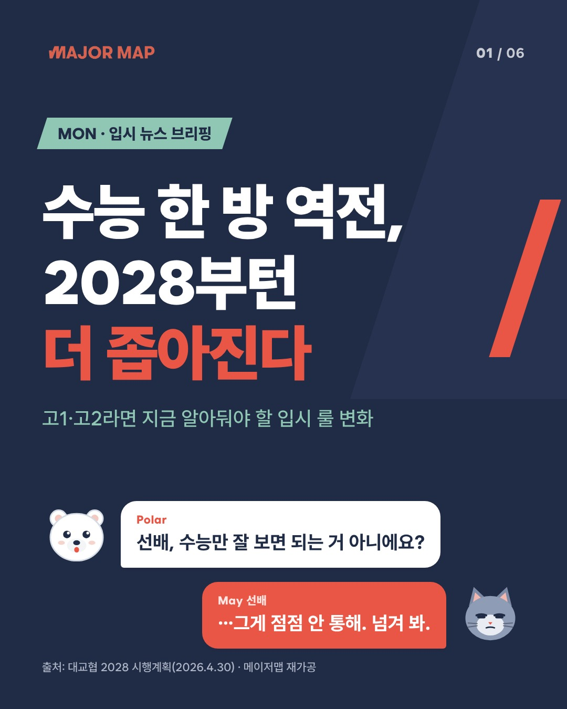

# MM_Insta — 메이저맵 인스타 카드뉴스 자동 생성 에이전트

기획안 v1(2026-10-17)의 **§9 2시간 MVP** 구현입니다.

> 명령 한 번에, 노션 소재 1건이 메이저맵 브랜드 카드 6장(JPEG) + 캡션 + 출처 JSON으로 나온다.



| 샘플 | 소재 | 결과 |
|---|---|---|
| [`samples/trend_2028_rules`](samples/trend_2028_rules) | 부록 C 샘플 — 노션 트렌드 리포트 §4 (2028 개편) | G1~G4 통과 |
| [`samples/skku_2027_jungsi`](samples/skku_2027_jungsi) | 아카이브 기사 — 성균관대 2027 정시 (학생부100%) | G1~G4 통과 |

샘플의 `facts.json`·작가 원고는 API 키 없이 렌더·게이트를 검증하려고 미리 써 둔 **오프라인 고정 데이터**입니다 (`fixtures/demo/`). 실제 운영에서는 Claude가 같은 형식으로 생성합니다.

---

## 파이프라인

```
① 소재 ── 노션 아카이브 DB (또는 로컬 JSON)
② 팩트 추출기 (Claude Sonnet 5.5) ── facts.json: 값·주장·출처·기준일·링크
③ 작가 May·Polar (Claude Sonnet 5.5) ── 6장 원고. 숫자는 {f1}처럼 팩트 id로만 씀
④ 검수 G1 팩트 · G2 원문유사도 · G3 톤·글자수 ── 실패 시 사유를 피드백으로 1회 재작성
⑤ 렌더러 ── HTML 템플릿 → 헤드리스 Chromium 캡처 → JPEG 1080×1350 ×6
   └ G4 렌더 검사 ── 글자 넘침·줄 수·캔버스 밖·Wanted Sans 로드 → 넘치면 글자 0.9배 축소 후 재검사
```

**숫자는 코드가 넣습니다.** 작가는 `{f3}`만 쓰고 렌더러가 `facts.json` 값으로 바꿉니다. G1은 (a) 팩트 값의 숫자가 소재 원문에 있는지, (b) 원고에 직접 쓴 숫자가 없는지, (c) 없는 팩트를 참조하지 않는지 검사합니다. 학년 표기(고1·고2)만 예외입니다.

| 게이트 | 이 MVP에서 | 1단계에서 추가 |
|---|---|---|
| G1 팩트 | 코드 (숫자 대조, 바꿔 말하기는 경고) | LLM 의미 대조 |
| G2 원문 유사도 | 코드 (6어절 연속 일치) | 기사 원문 텍스트로 비교 |
| G3 톤·안전 | 코드 (금칙어·슬롯별 글자 수·장 구조) | Haiku 5.5 톤 판정 |
| G4 렌더 | 코드 (DOM 넘침·줄 수·폰트·이미지·해상도·JPEG) | — |

게이트가 하나라도 실패하면 종료 코드 2로 끝나며 **발행 금지** 상태입니다 (§13-2).

## 빠른 시작

```bash
cd MM_Insta
pip install -r requirements.txt
python -m playwright install chromium        # 이미 Chromium이 있으면 .env에 MM_CHROMIUM_PATH 지정
cp .env.example .env                         # ANTHROPIC_API_KEY, NOTION_TOKEN 입력

# API 키 없이 데모 (고정 원고로 렌더·게이트만)
python -m mm_insta.pipeline --topic-file fixtures/topics/trend_2028_rules.json \
    --offline fixtures/demo/trend_2028_rules

# 실제 생성 — 아카이브에서 고1·2 키워드 최신 미사용 기사 1건 자동 선택
python -m mm_insta.pipeline --notion-latest

# 특정 기사 / 로컬 소재
python -m mm_insta.pipeline --notion-page 3fc6af6c8bcc812ba8afd5557d0c7abf
python -m mm_insta.pipeline --topic-file fixtures/topics/skku_2027_jungsi.json

python -m pytest -q                          # 게이트·렌더·LLM 배선 테스트
```

노션: [통합(integration)](https://www.notion.so/my-integrations)을 만들고 「📚 베리타스알파 구독자 기사 아카이브」 DB에 연결(공유)해야 `NOTION_TOKEN`으로 읽을 수 있습니다. `--notion-latest`는 키워드 `2028 개편`·`학생부 정성평가`·`반도체·AI·첨단`·`무전공·자유전공`·`수능최저` 기사 중 최신순으로 고르고, 통과한 소재 id를 `out/used_topics.json`에 기록해 중복을 피합니다.

### 출력 (`out/<날짜>_<제목>/`)

| 파일 | 내용 |
|---|---|
| `01.jpg`~`06.jpg` | 1080×1350 JPEG (인스타 캐러셀 규격) |
| `caption.txt` | 캡션 + 출처 + 원문 링크 + 해시태그 |
| `facts.json` | 팩트 목록 (id·값·주장·출처·기준일·링크·derived_from) |
| `script.json` | 부록 A 형식 카드 스크립트 (렌더러 입력) |
| `gate_report.json` | 시도별 G1~G3 결과, G4 장별 결과, 단계별 소요 시간 |
| `topic.json`, `writer.json`, `html/` | 디버그용 원재료 |

## 구조

```
MM_Insta/
├── mm_insta/
│   ├── pipeline.py          # 오케스트레이터 (CLI)
│   ├── config.py            # 브랜드 토큰·규격·모델·글자 수 제한·금칙어
│   ├── models.py            # Topic / Fact / 작가 출력 / script.json 변환
│   ├── llm.py               # Claude 호출: 구조화 출력 + 시스템 프롬프트 캐시 + 거절 시 서버측 폴백
│   ├── sources/notion.py    # 아카이브 DB 읽기 (Notion API)
│   ├── agents/prompts.py    # 팩트 추출기·작가 May·Polar 지침 (부록 B)
│   ├── gates/text_gates.py  # G1·G2·G3
│   └── render/renderer.py   # HTML → PNG → JPEG + G4
├── templates/mon_news/      # 디자이너가 고치는 곳: style.css + 01~06 템플릿
├── assets/                  # Wanted Sans(OFL), 로고(레드·화이트), 캐릭터
├── fixtures/                # 소재 2건 + 오프라인 데모 원고
├── samples/                 # 데모 결과물
├── supabase/migrations/     # 1단계용 스키마 (아직 미적용)
└── tests/
```

워크플로: 저장소 루트 [`.github/workflows/mm-insta-generate.yml`](../.github/workflows/mm-insta-generate.yml) — 수동 실행(workflow_dispatch), 결과물은 Artifact로 업로드. 저장소 Secrets에 `ANTHROPIC_API_KEY`, `NOTION_TOKEN` 필요.

## 디자인 메모

- 서체 **Wanted Sans** (OFL, npm `wanted-sans@1.0.3`의 woff2)를 저장소에 포함 → 실행 서버에 폰트가 없어도 동일하게 렌더. G4가 로드 여부를 확인합니다.
- 로고 색 규정: 흰·네이비·오프화이트 배경 → 레드 로고 / 레드·민트 배경 → 화이트 로고.
- 흰 글씨 on 레드(3.55:1)는 24px 이상 굵은 글씨에만. 레드 장의 출처 줄은 흰 면 위 네이비 글씨.
- 사선 모티프 `skewX(-18deg)`: 키커·majormap.net 버튼·단계 번호·배경 면.
- 템플릿 글자 크기는 모두 `calc(Npx * var(--fs))` — G4 넘침 시 `--fs: 0.9`로 1단계 축소.

## 아직 남은 것

- **캐릭터**: `assets/characters/may.svg`·`polar.svg`는 임시 그림입니다. 브랜드 원본을 `may.png`·`polar.png`로 넣으면 자동으로 그쪽을 씁니다. (오픈 이슈: 포즈·표정 3~4종 추가)
- **실 API 검증**: 이 환경에는 API 키·노션 토큰이 없어 LLM·노션 경로는 가짜 클라이언트 테스트(`tests/test_llm_wiring.py`)로만 확인했습니다. 키를 넣고 `--notion-latest`로 첫 실행 후 결과를 봐 주세요.
- **원문 문장 육안 확인** (DoD 4번째 항목): G2는 노션의 자체 요약과 비교합니다. 베리타스 원문과의 비교는 사람이 봐야 합니다.
- **1단계** (§10): 노션 '소재 DB' 신설·적재, 화~금 템플릿 4종, G1 LLM부·G3 Haiku 판정, 예비 소재 3세트, Actions 크론(19:00 KST), Supabase 저장(위 스키마), 슬랙 알림.
- **2단계**: 인스타 Graph API 발행 — 메타 앱·권한 신청이 리드타임이 가장 길어 **지금 시작**해야 합니다 (§8-1).
